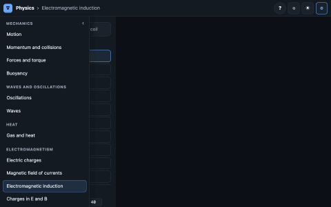

# ∇ Engineering Labs

**A collection of interactive tutorials for engineering subjects.** Every topic is a picture you can
move: drag a magnet through a coil and watch the flux and the induced current respond, slide a filter
over an image, step a sorting algorithm through real C++ code, or watch a flip-flop's waveform as its
gates switch — with the explanation one click away.

<p align="center">
  
</p>

**Author:** Giulio Russo · [GitHub](https://github.com/GiulioRusso) · [LinkedIn](https://www.linkedin.com/in/giuliorusso)

## ▶️ Open it

Clone or download the repository and double-click **`index.html`**. It opens the catalogue: one card per
subject and a search box over every topic. Each subject is a single self-contained file in `web/` that
runs in any browser, offline, with nothing to install.

| Subject | File | What is inside |
|---|---|---|
| Maths | [`web/maths.html`](web/maths.html) | functions and transformations · polynomials · limits · curve sketching · Newton · trigonometry and triangles · conic sections · complex numbers and functions · calculus and its applications · series · differential equations · vectors · matrices, eigenvectors, least squares · surfaces · multiple and line integrals · Lagrange multipliers · divergence and curl · probability and statistics |
| Physics | [`web/physics.html`](web/physics.html) | motion · momentum · forces · oscillations · waves · gravity · gas and heat · optics · electric charges · magnetic fields · induction · charges in fields · EM waves · flight · orbits · Lagrange points |
| Circuits | [`web/circuits.html`](web/circuits.html) | R, C, L with moving charges · Kirchhoff · Thévenin · superposition · the circuit as a 3D potential landscape · RLC transients · phasors · impedance and resonance · AC power · filters · matching · mixers and detectors |
| Analog electronics | [`web/analog-electronics.html`](web/analog-electronics.html) | diodes and rectifiers · BJT and MOSFET · bias and small signal · current mirror · amplifier stages · feedback · op-amps and their limits · Sallen-Key · CMOS inverter, delay, power, latch |
| Digital electronics | [`web/digital-electronics.html`](web/digital-electronics.html) | gates · adders · latches · flip-flops · counters · state machines — each circuit with its timing diagram |
| Computer science | [`web/computer-science.html`](web/computer-science.html) | arrays · sorting · stacks and queues · linked lists · trees and heaps · graphs (BFS, DFS, Dijkstra, Bellman-Ford, A*, Kruskal, max flow) · CPU scheduling · synchronization — real C++ runs, line by line |
| Signal theory | [`web/signal-theory.html`](web/signal-theory.html) | spectra · Fourier series and transform · DFT and FFT · windows · sampling · convolution · LTI systems · filters · spectral estimation · modulation · digital links · IQ · antennas and arrays · polarization · guided waves · propagation |
| Control systems | [`web/control-systems.html`](web/control-systems.html) | time response · poles · steady-state error · root locus · PID · Bode · Nyquist · compensators |
| Electronic warfare | [`web/electronic-warfare.html`](web/electronic-warfare.html) | pulses and range · waveforms and pulse compression · Doppler and range–Doppler maps · receivers · beams and arrays · clutter · radar equation · detection · MTI · PPI · jamming |
| Machine learning | [`web/machine-learning.html`](web/machine-learning.html) | the neuron · layers one at a time (activations, dense, hidden, convolution, pooling, softmax) · loss functions · optimizers on 3D loss surfaces · overfitting and regularization · classification metrics |

The full topic list is in [`docs/TOPICS.md`](docs/TOPICS.md).

## 🧪 How a topic works

Pick a topic in the left bar. On the right: its **cases** as tabs, then **Free** (every control) and
**examples**, each showing one idea with only its own controls. **?** opens the explanation for exactly
what is on screen: what you are looking at, the idea in plain words, the formula, a worked example and
the common mistakes. Every axis is labelled with its quantity and unit; a play bar appears only when
something evolves in time. The address bar always holds the exact view, so any moment can be shared as
a link.

## 🔨 Build

Only needed after changing a topic. The built pages are committed, and a fresh clone rebuilds them
byte-identically.

```bash
npm install
npm test          # model tests (physics, maths, circuits, ML…)
npm run build     # src/ + tracer/ → web/ and index.html
npm run smoke     # headless-Chrome run of every case and example of every page
```

The computer science and digital electronics topics are recorded from real C++ programs. To change one,
edit it under `tracer/algorithms/cpp/` or `tracer/electronics/cpp/` and run that folder's `./build.sh`
(it compiles, records the trace and checks it), then `npm run build`.

How the code is organised and how to add a topic: [`docs/GUIDE.md`](docs/GUIDE.md).

## 📂 Repository

```
index.html        the catalogue: double-click it
web/              built pages, one per subject (+ media/)
src/              source: src/lib/ (runtime, drawing helpers), src/<subject>/<lab>/ (model, lab, explanation)
tracer/           C++ programs recorded step by step (algorithms, electronics) and their renderers
tools/            tests, smoke test, screenshot capture, catalogue
catalog.json      the map: subject → topics
build.mjs         the build
docs/             guide and topic list
legacy/           archive: the original Jupyter notebooks and the old stand-alone visualizers
```
