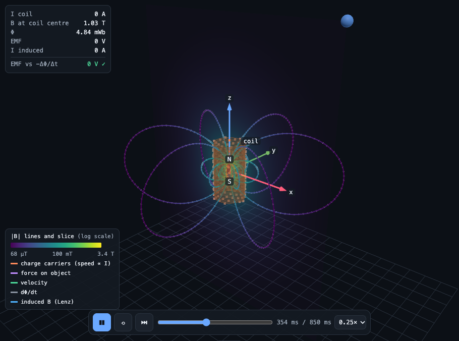

<p align="center">
  
</p>

<h1 align="center">Engineering Labs</h1>

**Interactive tutorials for engineering subjects.** Every topic is a visual experiment: drag magnets, step through C++ code, or tune filters—with deep explanations one click away.

<p align="center">
  
</p>

**▶ Try it online: [giuliorusso.github.io/Engineering-labs](https://giuliorusso.github.io/Engineering-labs/)**

**Author:** Giulio Russo · [GitHub](https://github.com/GiulioRusso) · [LinkedIn](https://www.linkedin.com/in/giuliorusso)

## 🚀 Quick Start

```bash
git clone https://github.com/GiulioRusso/Engineering-labs.git
cd Engineering-labs
```

Open **`index.html`** in any browser. Catalogue self-contained, runs offline.

## 📚 Subjects

| Subject | Entry | Key Topics |
|---|---|---|
| **Maths** | [`web/maths.html`](web/maths.html) | Calculus, Linear Algebra, Differential Equations, Complex Analysis |
| **Probability & Stats** | [`web/probability.html`](web/probability.html) | Distributions, Bayes, Monte Carlo, Hypothesis Testing |
| **Statistics** | [`web/statistics.html`](web/statistics.html) | Descriptive Statistics, Correlation, Sampling Distributions, MLE, Bootstrap, t Tests, p-values and Power, Chi-Square, ANOVA, Rank Tests, Regression Inference, Bayesian Updating |
| **Physics** | [`web/physics.html`](web/physics.html) | Mechanics, Oscillations and Waves, Heat, Electromagnetism (all four Maxwell equations), Optics |
| **Modern Physics** | [`web/modern-physics.html`](web/modern-physics.html) | Special Relativity, Photoelectric Effect, Particle in a Box, Hydrogen Spectrum, Decay |
| **Flight and Space** | [`web/flight-and-space.html`](web/flight-and-space.html) | Lift and Drag, Standard Atmosphere, Gliding, Breguet Range, Airfoils (Joukowski), Drag Polar, Take-off and Landing, Static Stability, Kepler's Laws, Newton's Cannon, Hohmann vs Bi-elliptic, Plane Changes, Rendezvous (Clohessy–Wiltshire), Patched Conics, Gravity Assist, Rocket Equation, Staging, Gravity Turn, Re-entry |
| **Robotics** | [`web/robotics.html`](web/robotics.html) | Rotations and Quaternions, DH and the Kinova Jaco2, Jacobian, CLIK, Redundancy, Trajectories, Dynamics, Computed Torque, Impedance Control |
| **Circuits** | [`web/circuits.html`](web/circuits.html) | RLC, Phasors, Impedance, AC Power, Filter Design |
| **Analog Electronics** | [`web/analog-electronics.html`](web/analog-electronics.html) | BJTs, MOSFETs, Op-Amps, Feedback, CMOS |
| **Digital Electronics** | [`web/digital-electronics.html`](web/digital-electronics.html) | Logic Gates, FSMs, Counters, Timing Analysis |
| **Computer Science** | [`web/computer-science.html`](web/computer-science.html) | Algorithms, Data Structures, CPU Scheduling (Real C++) |
| **Design Patterns** | [`web/design-patterns.html`](web/design-patterns.html) | Creational, Structural and Behavioural Patterns as Running C++ with Object Diagrams |
| **Signal Theory** | [`web/signal-theory.html`](web/signal-theory.html) | Fourier, Sampling, LTI Systems, Modulation, IQ |
| **Control Systems** | [`web/control-systems.html`](web/control-systems.html) | PID, Root Locus, Bode/Nyquist, Stability |
| **Electronic Warfare** | [`web/electronic-warfare.html`](web/electronic-warfare.html) | Pulse Compression, Radar Eq, Jamming, Doppler |
| **Machine Learning** | [`web/machine-learning.html`](web/machine-learning.html) | k-NN, Trees, Clustering, Linear and Logistic Regression, SVMs, Ensembles, ROC |
| **Deep Learning** | [`web/deep-learning.html`](web/deep-learning.html) | Neurons, Network Playground, Layers, Backprop, Initialisation, MNIST MLP and CNN |
| **Numerical Methods** | [`web/numerical-methods.html`](web/numerical-methods.html) | Root Finding, ODE Solvers, Stability, Interpolation, Quadrature |
| **Information Theory** | [`web/information-theory.html`](web/information-theory.html) | Entropy, Huffman Coding, Channel Capacity, Hamming Codes |
| **Structural Mechanics** | [`web/structural-mechanics.html`](web/structural-mechanics.html) | Beams, Cross Sections, Tensile Test, Mohr's Circle, Buckling |

Full list: [`docs/TOPICS.md`](docs/TOPICS.md).

## ⚙️ How it Works

- **Interactive Cases:** Switch between guided examples and a "Free" mode for full control.
- **Contextual Help:** Click **?** for formulas, plain-language theory, and common pitfalls.
- **Precision:** Every axis is labeled with units. Play-bars appear only for time-evolving systems.
- **Shareable:** The URL reflects the exact state of the lab.

## 🛠 Development

Built pages are committed. To rebuild:

```bash
npm install
npm test          # Model verification
npm run build     # Source → web/
npm run smoke     # Headless validation of all cases
```

For C++ traces (CS/Digital/Design patterns), edit `tracer/`, run local `./build.sh`, then `npm run build`.

Guide: [`docs/GUIDE.md`](docs/GUIDE.md).

## 📂 Structure

```
index.html    Catalogue entry point
web/          Built pages & media
src/          Source (Models, Labs, Explanations)
tracer/       C++ trace recording & rendering
tools/        Testing & build utilities
docs/         Technical guide & topic registry
```
