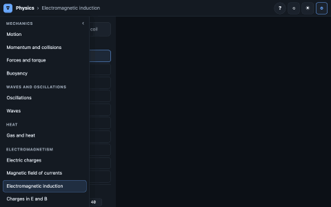

# 🧪 Engineering Labs — guide

Interactive lessons, one page per subject. You drag things in a 3D scene and the physics responds,
with linked plots, live readouts and the explanation one click away.

<p align="center">
  
</p>

## 🧭 Levels

| Level | Example | Where |
|---|---|---|
| **Subject** | Maths, Physics | one file: `web/<subject>.html` |
| **Topic** | Functions, Vectors, Oscillations | left bar: drag its edge to resize, ‹ hides it, the Topics tab brings it back |
| **Case** | Line, Parabola · Dot product, Cross product | tabs at the top right |
| **Example** | “At 90°: a·b = 0” | list under the tabs, after **Free** |

**Free** is the case from its simplest setting with every control and the full explanation. An
**example** shows one idea: only its own controls, and **?** explains only that example. At the bottom,
folded, **View** (what is drawn).

A case is a different idea or apparatus (line vs parabola, lens vs mirror). A mode that applies to many
examples is a setting, not a case: how the magnet moves, damping and drive, the gas process, Hohmann
vs bi-elliptic.

## ▶️ What you can launch

Only these files are meant to be opened. Each works by double-click, offline, with nothing installed:

| File | What it is |
|---|---|
| `index.html` (repository root) | the catalogue: one card per subject, search over every topic |
| `web/<subject>.html` | **one subject, all its topics**, e.g. `web/maths.html` |

The address bar always holds the exact view, e.g. `web/maths.html?lab=vectors&case=dot&ex=perp&ax=1.2`.
Everything under `src/` is source; it is not opened directly.

## 🗂️ How the code is organised

```
(repository root)
├── index.html                    # the catalogue (generated by build.mjs)
├── catalog.json                  # THE map: subject → topics (edit this)
├── build.mjs                     # builds web/<subject>.html, index.html and docs/TOPICS.md
├── package.json, package-lock.json   # build-time tools only, exact versions
├── src/
│   ├── lib/                      # shared by every topic
│   │   ├── lab.css               # layout and the semantic colour palette (dark and light)
│   │   ├── topic.html            # page template for a subject
│   │   ├── ui/                   # the runtime: topic.js (page, left bar), lab.js (cases, examples, panel,
│   │   │                         #   play bar, URL, ? drawer, keys), stage.js (3D scene), panel.js, plots.js,
│   │   │                         #   schema.js (ctx.schema(): a live SVG block schema in the plots dock), …
│   │   ├── viz/                  # drawing helpers: chart (2D plots in the scene), schematic (circuits with
│   │   │                         #   moving charges), blocks (block diagrams of physical systems with signal
│   │   │                         #   tiles on the wires), curves, surfaces, vectors, field lines, colormaps, …
│   │   ├── trace/                # trace-lab.js: shows a recorded C++ trace as a topic (code, view, waveform)
│   │   └── physics/              # shared physics + tests
│   └── <subject>/<lab>/          # one folder per lab: lab.js, explain.html, model.js, model.test.js
├── tracer/
│   ├── algorithms/               # cpp/ (instrumented C++), traces/ (recorded, committed), views/ (renderers,
│   └── electronics/              #   catalog.js), tools/check_traces.cjs, build.sh (compile, record, check)
├── tools/                        # test.mjs, smoke.mjs (+ smoke.sh), capture.mjs, catalogue.mjs
├── web/                          # BUILT, COMMITTED: <subject>.html, media/
├── docs/                         # this guide, TOPICS.md (generated)
└── legacy/                       # archive: notebooks, old visualizers
```

**One lab, several topics.** A topic in `catalog.json` names its lab with `from` and may keep only some
of its cases with `cases`. `maths/vector-fields` serves three topics: *Vectors* (`dot`, `cross`),
*Divergence and curl* (`div`, `curl`) and, in physics, *Gravitational field* (`"from":
"maths/vector-fields"`, `gravity`). The ? drawer shows only the sections of the topic's cases.

Three rules hold everything together:

- **Physics never touches the page.** Every model is a plain module that node imports and tests.
- **A lab is a definition, not a page.** `lab.js` lists its cases, examples, controls, plots and readouts
  as data and provides one `setup(ctx)` that builds the scene and returns `update()`. The runtime owns
  everything else, so every topic behaves the same way.
- **One file per subject.** `build.mjs` bundles a subject's labs with esbuild into a single HTML file
  (JS and CSS inlined, explanations pre-rendered to MathML by KaTeX). Budget 3 MB.

## ✍️ Writing a lab

```js
cases: [
  { id: 'dot', label: 'Dot product', set: { ax: 1.6, bx: 0.6, by: 1.4 },   // the simplest setting
    examples: [{ id: 'perp', label: 'At 90°: a·b = 0', set: { bx: 0, by: 1.5 } },  // added on top of the case
               { id: 'swap', label: 'Swap a and b', set: { … }, controls: ['ax', 'bx'] }] },
// an example shows example.controls, else case.controls, else the controls its `set` changes
],
```

`explain.html`: the case sections are shown in Free, each example section with its example; untagged
elements show everywhere.

```html
<section data-case="dot"><h3>The dot product</h3> … $$\mathbf a\cdot\mathbf b = |\mathbf a||\mathbf b|\cos\theta$$</section>
<section data-case="dot" data-example="perp"><h3>Perpendicular</h3> …</section>
<section data-case="dot cross">… shared by both cases …</section>
```

A case section is written for a student meeting the idea for the first time, with these building blocks
(styled in `lib/lab.css`):

```html
<div class="look"><h4>What you are looking at</h4>what each panel shows</div>
<p>the idea in plain words, before any formula</p>
<div class="eq">$$…$$</div>
<ol class="steps"><li>how to reason, step by step</li></ol>
<div class="worked"><h4>Worked example</h4>real numbers, checked</div>
<div class="pitfall"><h4>Common mistakes</h4>what students usually get wrong</div>
<div class="try"><h4>Try it</h4>one thing to do with the controls</div>
```

Example sections stay short: what this preset shows and why.

Style: short labels, hints as tooltips, start from the basics, one idea per example. Topics carry a
`group` in `catalog.json` (sections of the left bar and of the home page). Prefer flat 2D views; offer 3D
as a View option only where it adds something (`view3d` + `camOf(state)` in the lab definition).

Adding a topic:
1. Add it to `catalog.json` (id, title, what, and `from`/`cases` if it reuses a lab).
2. Write `model.js` and `model.test.js` (checks against analytic results, conservation laws or an
   independent method). `npm test` until it passes.
3. Write `lab.js` (copy a similar one: `maths/function-explorer` for 2D, `physics/oscillations` for
   something that moves) and `explain.html`.
4. `npm run build`, then `npm run smoke` (zero failures) and `npm run capture <subject> --only <id>`.

Topic ids are global: two subjects cannot share one (thumbnails are `web/media/<id>.png`). When a topic
moves to another subject, add it to the old subject's `"moved": { "<id>": "<new subject>" }` in
`catalog.json`: old links (`?lab=<id>`) are forwarded to the new page.

Trace subjects (`"trace": "<dir>"` in `catalog.json`) are listed by `tracer/<dir>/views/catalog.js`; an item's
`what` becomes the topic's one-line description, and `tracer/<dir>/explain/<id>.html`, when present, replaces the
explanation generated from the C++ header comment. Design patterns (`tracer/patterns/`) record object diagrams:
`cpp/tracer/objects.hpp` provides the scene (`S.obj`, `S.rel`, `S.json(from, to, label)`) and `say()` for the
program's output; scene updates live inside `T.at(...)…emit();` chains so the code panel shows only the pattern.
Coding (`tracer/coding/`) has no C++ tracer: each program is written once as a JavaScript twin
(`programs-*.mjs`) that records steps against line ids marked `@@N` in its Python, C++, JavaScript and Java
sources; `node tracer/coding/build.mjs` regenerates the traces, and the code panel switches language.
The robotics labs share `src/robotics/kin/model.js` (rotations, quaternions, DH, Jacobians, pseudo-inverse,
two-link dynamics, trapezoidal and polynomial profiles); the Jaco2 DH table is the course model used in the
Jaco2 project.
The statistics labs share `src/statistics/core/model.js` (log-gamma, incomplete gamma and beta, the normal, t,
χ², F and beta distributions with quantiles, ranks, correlation, least squares) and `core/draw.js` (histogram
bars, box plots).

Block diagrams come in two forms. In the scene, `src/lib/viz/blocks.js` draws physical blocks (antenna,
filter, amplifier, mixer, oscillator, ADC/DAC, circulator, memory…) with signal tiles on the wires; the
electronic-warfare `systems` and `receiver` labs use it. In the dock, `ctx.schema({ items, wires, tiles })`
(`src/lib/ui/schema.js`) adds a live SVG schema on a grid to the left of the plots — feedback loops,
modulators, filters, Shannon's chain — and `update({ lit, tiles, text })` lights blocks and refreshes the
signals; it needs no free space in the scene and follows the theme by itself.

Data: `src/deep-learning/data/mnist.js` is generated by `node tools/mnist.mjs <dir>` from the four original
MNIST `.gz` files (balanced 300 + 100 per digit, 14 × 14, 4 bits; CC BY-SA 3.0). The deep-learning labs
share one small network engine, `src/deep-learning/net/model.js` (dense layers, backpropagation, SGD/Adam).

## ✅ Testing

- `npm test`: model checks, e.g. ring field vs brute-force Biot–Savart (4×10⁻⁶), long solenoid vs μ₀nI
  (0.03 %), Gauss's law (< 0.01 %), Boris energy drift (10⁻¹²), E×B drift (0.2 %), adiabatic heating vs
  2^(2/3), Kepler III, J2 sun-synchronous rate, Lagrange equilibria, Hohmann Δv, Fresnel R + T = 1,
  pendulum period vs the AGM formula (10⁻⁵), resonance amplitude (0.2 %), driven phase lag (0.6°);
  bead on a track: K + U (+ heat) conserved (10⁻⁶ / 10⁻⁴), loop detachment height (0.2 %); incline: slip at
  tan θ = μs (10⁻⁹), Atwood; rolling accelerations and energy (10⁻¹²); Carnot and Otto efficiencies (10⁻⁹),
  p–V loop area = net work (10⁻⁴); chain normal modes vs closed form (10⁻¹⁰), beats (10⁻¹²); diffraction vs
  2000 Huygens wavelets (10⁻⁶), N − 2 secondary maxima; heat conduction steady state, series resistances
  (10⁻³), Gaussian spreading (1 %); Lorentz interval invariance (10⁻¹²), light clock = γ; box states
  orthonormal, Hα 656.47 nm; Bateman vs RK4 (10⁻⁸), Monte Carlo half-life within 3σ;
  networks: backpropagation vs finite differences for every activation and output (10⁻⁵) and for the CNN
  (10⁻⁴), XOR learned with a hidden layer, MNIST accuracies (softmax regression, MLP, CNN); SVM margin vs a
  brute-force search over directions (1 %); AdaBoost error below its bound; empirical AUC = Mann–Whitney;
  Maxwell: zero magnetic flux through any sphere round a magnet (1 % of the outflow), ∮B·dl = I enclosed for
  circles and squares (10⁻⁵), ring field vs Biot–Savart (10⁻⁶); flight and space: equal areas πab/n (10⁻⁶), T²/a³
  for the planets, the cannon's apoapsis vs RK4, burnout speed = ideal − gravity − drag, Allen–Eggers (10⁻⁴),
  RK4 flyby turn angle, best glide and Breguet range; robotics: Jacobians vs finite differences (Jaco2 included),
  Euler/quaternion round trips, two-link energy conservation, CLIK error and null-space motion, PD sag K_P⁻¹g,
  computed torque, impedance contact force kK_PΔ/(K_P + k); statistics: t, χ² and F table values, densities
  vs their CDFs, Anscombe's r = 0.816, σ/√n, bootstrap and slope-interval coverage (≈ 95 %), uniform p-values
  under H₀, 1 − 0.95²⁰ family-wise rate, E[F] = df₂/(df₂ − 2), Mendel's χ² = 0.47; aerodynamics: Joukowski C_L
  vs the closed form, least drag at equal friction and induced drag, ground roll ∝ W², Cmα = 0 at the neutral
  point; manoeuvres: bi-elliptic crossovers 11.94 and 15.58, Clohessy–Wiltshire drift 6πΔv/n, two-burn
  rendezvous, Earth–Mars v∞ and Δv.
- `npm run smoke`: loads every subject page from `file://` in headless Chrome and runs every case and
  every example. Fails on a console error, a network request, a WebGL context loss, a blank scene, or a
  case or example without its explanation; checks that the catalogue links every topic.

Drag the top edge of the plots to make them taller (double-click: large). Sizes are remembered.
Keyboard: `Space` play/pause, `R` reset the case or example, `1`–`4` cameras, `Esc` close.
