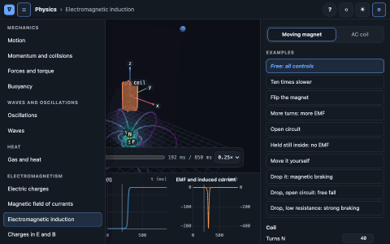

# 🧪 Labs — guide

Interactive lessons, one page per subject. You drag things in a 3D scene and the physics responds,
with linked plots, live readouts and the explanation one click away.

<p align="center">
  
</p>

## 🧭 Levels

| Level | Example | Where |
|---|---|---|
| **Subject** | Maths, Physics | one file: `web/<subject>.html` |
| **Topic** | Functions, Vectors, Oscillations | left bar (☰ folds it) |
| **Case** | Line, Parabola · Dot product, Cross product | tabs at the top right |
| **Example** | “At 90°: a·b = 0” | list under the tabs |

Every case starts from its simplest setting; each example adds one idea on top of it. **?** opens the
explanation of the topic and the selected case, and of the selected example when there is one.
Below the examples: the controls the case uses; at the bottom, folded, **View** (what is drawn).

## ▶️ What you can launch

Only these files are meant to be opened. Each works by double-click, offline, with nothing installed:

| File | What it is |
|---|---|
| `../index.html` (repository root) | the catalogue: one card per subject |
| `web/index.html` | the same catalogue, from inside `labs/` |
| `web/<subject>.html` | **one subject, all its topics**. Today: `maths.html` (8 topics), `physics.html` (18) |

The address bar always holds the exact view, e.g. `web/maths.html?lab=vectors&case=dot&ex=perp&ax=1.2`.
Everything under `src/` is source; it is not opened directly.

## 🗂️ How the code is organised

```
labs/
├── catalog.json                  # THE map: subject → topics (edit this)
├── TOPICS.md                     # the same map as a table (generated by build.mjs)
├── build.mjs                     # builds web/<subject>.html and both catalogues
├── package.json, package-lock.json   # build-time tools only, exact versions
├── src/
│   ├── lib/                      # shared by every topic
│   │   ├── lab.css               # layout and the semantic colour palette (dark and light)
│   │   ├── topic.html            # page template for a subject
│   │   ├── ui/                   # the runtime and its widgets
│   │   │   ├── topic.js          #   subject page: header, left bar, switching topics
│   │   │   ├── lab.js            #   runs one topic: cases, examples, panel, play bar, URL, ? drawer, keys
│   │   │   ├── stage.js          #   3D scene, cameras, orbit controls, render on demand
│   │   │   ├── panel.js          #   case tabs, examples, controls, View
│   │   │   ├── explain.js        #   the ? drawer, filtered to case and example
│   │   │   ├── playbar.js, plots.js, hud.js, handles.js, theme.js, …
│   │   ├── viz/                  # drawing helpers: curves, vectors, arrows, field lines, particles,
│   │   │                         #   slices, surfaces, 2D graphs, knobs, colormaps, legend
│   │   └── physics/              # shared physics (current loops, axisymmetric fields) + tests
│   ├── maths/<lab>/              # one folder per lab, e.g. maths/vector-fields:
│   │   ├── lab.js                #   cases, examples, controls, plots + setup()
│   │   ├── explain.html          #   the explanations ($$TeX$$ allowed)
│   │   └── model.js, *.test.js   #   the maths/physics, pure JS, tested in node
│   └── physics/<lab>/            # same pattern
├── tools/                        # test.mjs, smoke.mjs (+ smoke.sh), capture.mjs, catalogue.mjs
└── web/                          # BUILT, COMMITTED: <subject>.html, index.html, media/
```

**One lab, several topics.** A topic in `catalog.json` names its lab with `from` and may keep only some
of its cases with `cases`. `maths/vector-fields` serves three topics: *Vectors* (`dot`, `cross`),
*Divergence and curl* (`div`, `curl`) and, in physics, *Gravitational field* (`"from":
"maths/vector-fields"`, `gravity`). The ? drawer shows only the sections of the topic's cases.

Three rules hold everything together:

- **Physics never touches the page.** Every model is a plain module that node imports and tests.
- **A lab is a definition, not a page.** `lab.js` lists its cases, examples, controls, plots and readouts
  as data and provides one `setup(ctx)` that builds the scene and returns `update()`. The runtime owns
  everything else, so every topic behaves the same way.
- **One file per subject.** `build.mjs` bundles a subject's labs with esbuild into a single HTML file
  (JS and CSS inlined, explanations pre-rendered to MathML by KaTeX). Budget 3 MB.

## ✍️ Writing a lab

```js
cases: [
  { id: 'dot', label: 'Dot product', set: { ax: 1.6, bx: 0.6, by: 1.4 },   // the simplest setting
    controls: ['ax', 'ay', 'bx', 'by'],                                     // optional: controls shown
    examples: [{ id: 'perp', label: 'At 90°: a·b = 0', set: { bx: 0 } }] }, // added on top of the case
],
```

`explain.html` has one section per case and one per example; untagged elements show everywhere.

```html
<section data-case="dot"><h3>The dot product</h3> … $$\mathbf a\cdot\mathbf b = |\mathbf a||\mathbf b|\cos\theta$$</section>
<section data-case="dot" data-example="perp"><h3>Perpendicular</h3> …</section>
<section data-case="dot cross">… shared by both cases …</section>
```

Style: short labels, hints as tooltips, start from the basics, one idea per example.

Adding a topic:
1. Add it to `catalog.json` (id, title, what, and `from`/`cases` if it reuses a lab).
2. Write `model.js` and `model.test.js` (checks against analytic results, conservation laws or an
   independent method). `npm test <lab>` until it passes.
3. Write `lab.js` (copy a similar one: `maths/function-explorer` for 2D, `physics/oscillations` for
   something that moves) and `explain.html`.
4. `npm run build`, then `npm run smoke` (zero failures) and `npm run capture <subject> --only <id>`.

## ✅ Testing

- `npm test`: model checks, e.g. ring field vs brute-force Biot–Savart (4×10⁻⁶), long solenoid vs μ₀nI
  (0.03 %), Gauss's law (< 0.01 %), Boris energy drift (10⁻¹²), E×B drift (0.2 %), adiabatic heating vs
  2^(2/3), Kepler III, J2 sun-synchronous rate, Lagrange equilibria, Hohmann Δv, Fresnel R + T = 1,
  pendulum period vs the AGM formula (10⁻⁵), resonance amplitude (0.2 %).
- `npm run smoke`: loads every subject page from `file://` in headless Chrome and runs every case and
  every example. Fails on a console error, a network request, a WebGL context loss, a blank scene, or a
  case or example without its explanation; checks that both catalogues link every topic.

Keyboard: `Space` play/pause, `R` reset the case or example, `1`–`4` cameras, `Esc` close.
