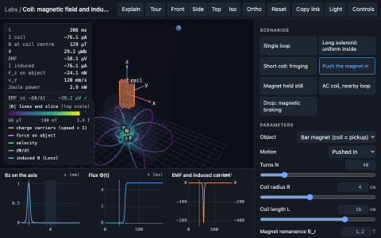

# 🧪 Labs — guide

Interactive animations, one page per topic. You drag things in a 3D scene and the physics responds,
with linked plots, live readouts and the theory one click away.

<p align="center">
  
</p>

## ▶️ What you can launch

Only these files are meant to be opened. Each works by double-click, offline, with nothing installed:

| File | What it is |
|---|---|
| `../index.html` (repository root) | the catalogue: one card per topic |
| `web/index.html` | the same catalogue, from inside `labs/` |
| `web/<topic>.html` | **one topic, all of its animations**, with a sidebar. Today: `physics.html` (13), `maths.html` (6) |

The address bar always holds the exact view, e.g. `web/physics.html?lab=coil-induction&scenario=drop&Rc=0.2`.
Everything under `src/` is source; it is not opened directly.

## 🗂️ How the code is organised

```
labs/
├── catalog.json                  # THE map: topic → animations (edit this)
├── TOPICS.md                     # the same map as a table (generated by build.mjs)
├── build.mjs                     # builds web/<topic>.html and both catalogues
├── package.json, package-lock.json   # build-time tools only, exact versions
├── src/
│   ├── lib/                      # shared by every animation
│   │   ├── lab.css               # layout and the semantic colour palette (dark and light)
│   │   ├── topic.html            # page template for a topic
│   │   ├── ui/                   # the runtime and its widgets
│   │   │   ├── topic.js          #   topic page: header, sidebar, switching animations
│   │   │   ├── lab.js            #   runs one animation: panel, play bar, URL, theory drawer, keys
│   │   │   ├── stage.js          #   3D scene, cameras, orbit controls, render on demand
│   │   │   ├── panel.js          #   scenario, its controls, View
│   │   │   ├── playbar.js, plots.js, hud.js, explain.js, handles.js, theme.js, …
│   │   ├── viz/                  # drawing helpers: curves, vectors, arrows, field lines, particles,
│   │   │                         #   slices, surfaces, 2D graphs, knobs, colormaps, legend
│   │   └── physics/              # shared physics (current loops, axisymmetric fields) + tests
│   ├── physics/                  # one folder per animation, e.g.
│   │   └── coil-induction/
│   │       ├── lab.js            #   the animation: data (controls, scenarios, plots) + setup()
│   │       ├── explain.html      #   the theory shown in the Theory drawer ($$TeX$$ allowed)
│   │       └── model/ or model.js, *.test.js   # the physics, pure JS, tested in node
│   └── maths/                    # same pattern
├── tools/                        # test.mjs, smoke.mjs (+ smoke.sh), capture.mjs, catalogue.mjs
└── web/                          # BUILT, COMMITTED: <topic>.html, index.html, media/
```

Three rules hold everything together:

- **Physics never touches the page.** Every model is a plain module that node imports and tests. The
  scene reads the model; the model never reads the scene.
- **An animation is a definition, not a page.** `lab.js` lists its settings, scenarios, plots and readouts
  as data and provides one `setup(ctx)` that builds the scene and returns `update()`. The runtime
  (`lib/ui/lab.js`) owns everything else, so every animation behaves the same way.
- **One file per topic.** `build.mjs` bundles a topic's animations with esbuild into a single HTML file
  (JS and CSS inlined, theory pre-rendered to MathML by KaTeX). Budget 3 MB; physics is about 1 MB.

## 🎛️ The settings panel

Always in this order, kept short (hints are tooltips, not text):

1. **Scenario**: the first one is the simplest; each next one adds one idea. A scenario picks the mode
   (there are no separate mode switches) and sets every value below.
2. **Controls**: only the ones the scenario uses. A scenario can list them (`controls: ['V', 'h']`);
   otherwise each control's `show(state)` decides.
3. **View** (folded): what is drawn. None of it changes the physics.

The play bar sits on the scene: play/pause, restart, step, a time scrubber and the playback speed.
Physics that lives in microseconds (a proton's gyration) or days (an orbit) keeps SI time: the
animation sets a time scale and the play bar shows the simulated time.

Header: **Theory**, **⟲** reset view, theme. Keyboard: `Space` play/pause, `R` reset scenario, `1`–`4` cameras, `Esc` close.

## ✍️ Adding an animation (6 steps)

1. Pick a planned animation in `catalog.json` (it already has a topic, id and description).
2. Create `src/<topic>/<id>/model.js` with the physics and `model.test.js` with checks against analytic
   results, conservation laws or an independent method. Run `npm test <id>` until it passes.
3. Create `src/<topic>/<id>/lab.js`. Copy a similar one (`maths/function-explorer` for 2D,
   `physics/point-charges` for 3D fields, `physics/motion-energy` for something that moves).
4. Write `explain.html`: short sections, one equation each, plus *About the model* (method and the
   measured errors).
5. `npm run build`. The animation appears in its topic page and in the catalogue by itself.
6. `npm run smoke` must report zero failures; `npm run capture <topic> --only <id>` makes its thumbnail.

## ✅ Testing

- `npm test`: 77 model checks today, e.g. ring field vs brute-force Biot–Savart (4×10⁻⁶), long solenoid
  vs μ₀nI (0.03 %), Gauss's law (< 0.01 %), Boris energy drift (10⁻¹²), E×B drift (0.2 %), gas pressure
  vs NkT/V, adiabatic heating vs 2^(2/3) (1.3 %), Kepler III and vis-viva, J2 sun-synchronous rate,
  Lagrange equilibria, Jacobi constant, Hohmann Δv, Fresnel R + T = 1, lens equation, Taylor error order.
- `npm run smoke`: loads every topic page from `file://` in headless Chrome and runs every animation and
  every scenario. Fails on a console error, any network request, a WebGL context loss or a blank scene;
  checks that both catalogues link every animation; prints frame times.
- The same invariants are shown live in each animation's readouts (✓ when they hold).

Measured on an Apple M5 (headless Chrome, Metal): every animation runs at 60 fps, 0.4–1.8 ms per frame
median.
